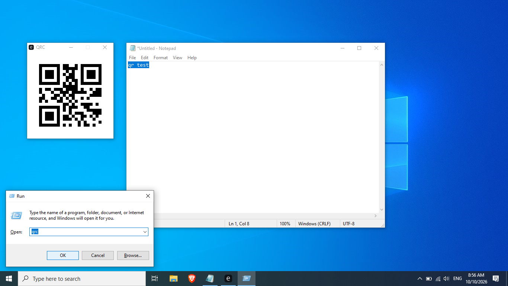

# QR Utils (qr & qrc)

A minimalistic, lightning-fast, and fully offline set of QR code utilities for Windows, written in Rust.



## Features

- **qr**: Press `Win + R` and type `qr`. A tiny, minimalist prompt appears. Type any text, press `Enter`, and it instantly morphs into a perfectly sized QR code.
- **qrc**: Press `Win + R` and type `qrc`. Instantly displays a QR code of whatever text is currently in your clipboard.
- **Minimalist UI**: Clean, distraction-free interface with a pure white background, perfectly sized for the QR code.
- **Fully Offline**: 100% local, no internet connection required.
- **Memory Safe**: Written in Rust for maximum security.

## Quick Download

You don't need to compile anything! Just download the ready-to-use `.exe` files directly from this repository:
- [📥 Download qr.exe](QRUtils/qr.exe)
- [📥 Download qrc.exe](QRUtils/qrc.exe)

## Usage

1. Download the `.exe` files from the links above.
2. Place them in a secure folder on your PC (e.g. `C:\QRUtils`).
3. Add that folder to your Windows `PATH` environment variable.
4. Press `Win + R` and type `qr` or `qrc` to generate QR codes instantly!

## Building from source

Make sure you have Rust and Cargo installed, then run:

```bash
cargo build --release
```
The executables will be located in the `target/release/` directory.
